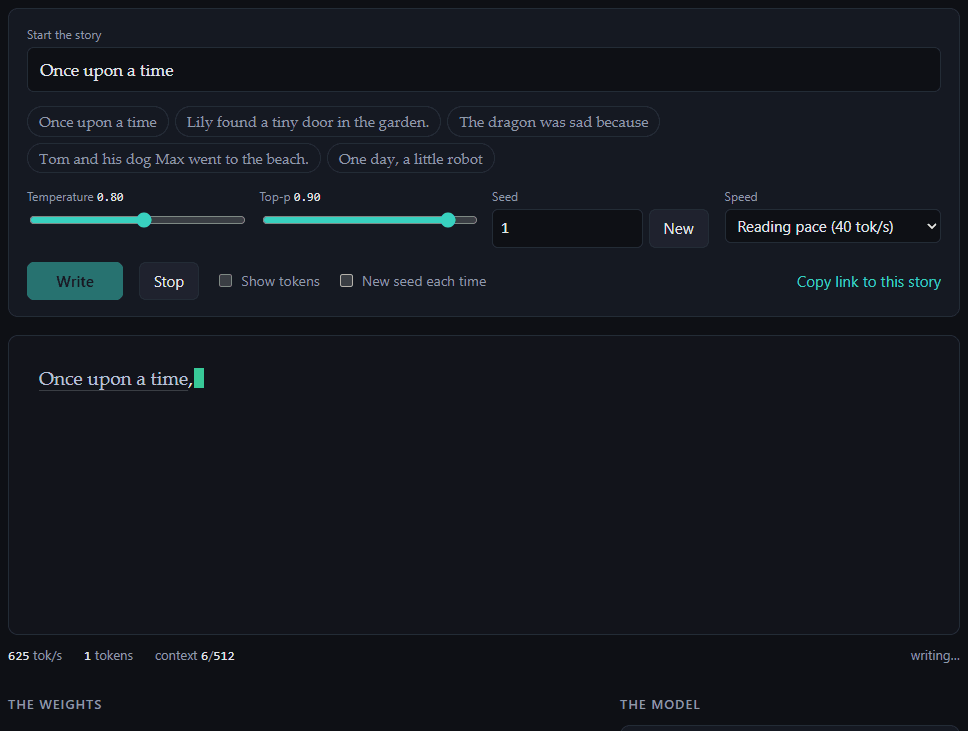
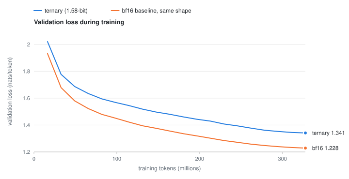
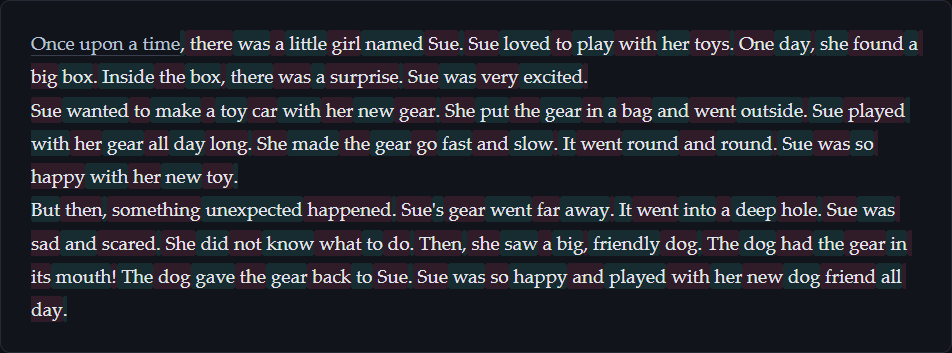
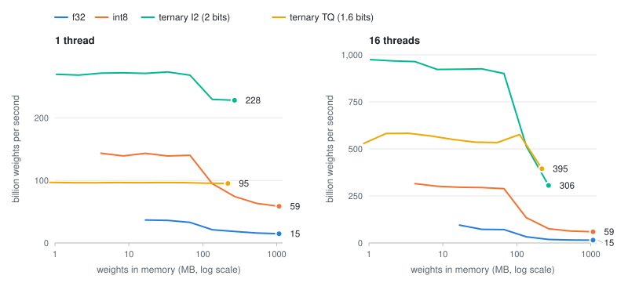
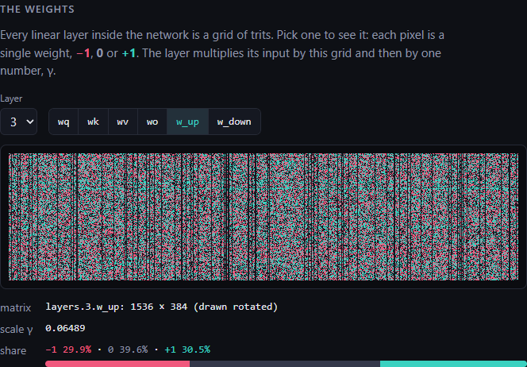

<p align="center">
  
</p>

<h1 align="center">trit</h1>

<p align="center">
  A language model whose weights are all &minus;1, 0 or +1, end to end: trained from scratch on TinyStories, run by hand-written ternary kernels for AVX2, AVX-512 and WebAssembly SIMD, and small enough to write stories in a browser tab from a 4.6 MB file.
</p>

<p align="center">
  <a href="https://autumntrace.github.io/trit/"><b>Open the live demo</b></a>
</p>

<p align="center">
  <a href="https://github.com/AutumnTrace/trit/actions/workflows/ci.yml"></a>
  <a href="https://github.com/AutumnTrace/trit/actions/workflows/pages.yml"></a>
  <a href="LICENSE"></a>
  <a href="models/README.md"></a>
</p>

## What this is

[BitNet b1.58](https://arxiv.org/abs/2402.17764) showed that a transformer can be trained with every weight restricted to three values, &minus;1, 0 and +1, and still work. A matrix multiply against such weights needs no multiplications: each weight adds an activation, subtracts it, or skips it. Three values carry log<sub>2</sub>3 &asymp; 1.58 bits each, so the weights also shrink by a factor of ten or more against 16- or 32-bit floats.

trit is that idea at a size one person can train in an hour and read in an afternoon:

- **a 15.7M-parameter model** (8 layers, width 384) trained with quantization-aware training on [TinyStoriesV2](https://huggingface.co/datasets/roneneldan/TinyStories), next to a bf16 model of the same shape trained on the same tokens, so the cost of going ternary is measured rather than assumed;
- **a Rust inference engine with no dependencies** outside `std`: file loader, byte-level BPE tokenizer, KV cache, sampling, and GEMV kernels for packed ternary weights in scalar code, AVX2, AVX-512 VNNI and WebAssembly SIMD128;
- **a web page** that runs the same engine as a 121 KB WebAssembly module in a worker, writes stories at about 800 tokens/s, and shows you every weight matrix pixel by pixel.

The same seed writes the same story in the CLI and in the browser, byte for byte, and the Rust engine matches a PyTorch reference to within 1e-6 of the logit range.

## Results

Both models have the same shape and saw the same 327.7M training tokens (20,000 steps of 32 x 512) on the same data order; only the linear layers differ. Validation loss is the mean cross-entropy over the first 655,360 tokens of the TinyStoriesV2 validation split.

| | ternary (BitLinear) | baseline (`nn.Linear`, bf16 autocast) |
|---|---|---|
| validation loss | **1.341** | **1.228** |
| perplexity | 3.82 | 3.42 |
| weights inside the blocks | 14.2M trits, 2.83 MB at 1.6 bits | 14.2M floats, 28.3 MB in bf16 |
| whole model file | 4.57 MB | 31.5 MB in bf16 (not exported) |
| peak learning rate | 2e-3 | 1e-3 |
| training time on the RTX 5070 | 51 min (106k tokens/s) | 27 min (206k tokens/s) |

<p align="center">
  <picture>
    <source media="(prefers-color-scheme: dark)" srcset="docs/media/loss-dark.svg">
    
  </picture>
</p>

Going ternary costs **0.113 nats per token** at this size: perplexity 3.82 against 3.42. The gap opens early and then holds steady (0.09 after 16M tokens, 0.12 after 164M, 0.11 at the end), so more training of the same kind would not close it; the baseline had already reached the ternary model's final loss after 180M tokens, 55% of the budget. That is in line with the BitNet papers, which find ternary models catching up with full precision only at billions of parameters, not at 15 million. In exchange, the weights inside the blocks are ten times smaller than the baseline's in bf16, and the stories (below) are still fluent.

Ternary training is also slower per token, because every forward pass re-quantizes every weight matrix and activation. Both runs shared the GPU with other programs, so the times are what it took on this machine rather than what the card can do ([devlog](docs/devlog.md#the-gpu-was-busy)).

The exported file loses nothing measurable against the training run: `trit_train.reference` scores the file itself (trits, int8 embedding, float32 arithmetic) at 1.3411 against 1.3412 for the training-time evaluation in bf16. Logs and summaries of both runs are in [train/results](train/results).

## Samples

Unedited, the first seeds tried, default settings (temperature 0.8, top-p 0.9). The full set, with the exact commands, is in [train/results/samples.md](train/results/samples.md).

> **seed 1:** Once upon a time, there was a little girl named Sue. Sue loved to play with her toys. One day, she found a big box. Inside the box, there was a surprise. Sue was very excited.
> Sue wanted to make a toy car with her new gear. She put the gear in a bag and went outside. Sue played with her gear all day long. She made the gear go fast and slow. It went round and round. Sue was so happy with her new toy.
> But then, something unexpected happened. Sue's gear went far away. It went into a deep hole. Sue was sad and scared. She did not know what to do. Then, she saw a big, friendly dog. The dog had the gear in its mouth! The dog gave the gear back to Sue. Sue was so happy and played with her new dog friend all day.

> **seed 2:** Once upon a time, there was a little boy named Tim. Tim loved to play with his toy cars. One day, he saw a shiny scale on the floor. Tim was very happy.
> Tim wanted to show his friend, Sam. He took the scale and went to Sam's house. Sam was a bit grumpy. They played with the scale, but they did not know that the scale was magic.
> Tim and Sam played with the glowing car all day. They took turns using the magic scale. They laughed and had lots of fun. When it was time to go home, Tim put the magic scale back on the shelf. They were not grumpy anymore.

The grammar is reliable; the plot is not. Objects change identity (the scale becomes a "glowing car"), a box's surprise is forgotten a sentence later, and in seed 3 a lost rock is put on a pillow after nobody could find it. Greedy decoding loops ("He made the car go fast and slow, and he was very careful. He made the car go fast and slow, and he was very careful with it."), at temperature 1.4 it falls apart into invented words within a line, and a prompt about the stock market turns into a story about a girl, a bird and a trade.

With "Show tokens" on, the page tints every token, which makes the 4,096-token vocabulary visible: common words are one token, rarer ones are split.

<p align="center">
  
</p>

## Speed

Measured on one desktop: Windows 11 Pro, AMD Ryzen 7 9800X3D (Zen 5, 8 cores, AVX-512 with VNNI, 96 MB L3), DDR5, Rust 1.100, and headless Chrome 158. Benchmarks ran after training had finished, but on a desktop with other applications open, so treat differences of a few percent as noise. Raw results are in [bench/](bench).

**Generating stories**, single-threaded, 5 stories of up to 256 tokens (`trit bench`, `npm run bench`):

| where | kernel | layout | tokens/s |
|---|---|---|---|
| native CLI | scalar | I2 | 642 |
| native CLI | AVX2 | I2 | 2,289 |
| native CLI | AVX-512 VNNI | I2 | 2,350 |
| native CLI | scalar | TQ | 271 |
| native CLI | AVX2 | TQ | 1,477 |
| native CLI | AVX-512 VNNI | TQ | 1,787 |
| Chrome 158.0.8127.38, WebAssembly | SIMD128 | I2 | 814 |

**One GEMV**, single-threaded, `cargo bench -p trit-kernels --bench gemv`. Billions of weights per second, so the formats are compared on the same work; the ternary kernels also report how many bytes they stream:

| shape (rows x cols) | f32 | int8 | I2 AVX2 | I2 AVX-512 | TQ AVX2 | TQ AVX-512 |
|---|---|---|---|---|---|---|
| 384x384 (this model) | 38 | **155** | 138 | 151 | 39 | 56 |
| 1536x384 (this model) | 37 | **199** | 139 | 151 | 39 | 56 |
| 384x1536 (this model) | 37 | 204 | 154 | **270** | 49 | 93 |
| 4096x4096 (Llama-7B size) | 33 | 151 | 157 | **203** | 51 | 111 |
| 11008x4096 (Llama-7B size) | 22 | 149 | 157 | **204** | 51 | 111 |

At this model's own shapes, rows are only 384 columns long (three I2 blocks), so per-row overhead is a large share and plain int8 is as fast or faster. On the 4096-wide shapes, I2 with VNNI does about 1.35 times as many weights per second as int8 and 6 to 9 times as many as f32, while reading a quarter of int8's bytes. TQ pays for its smaller size with decode work: about half the speed of I2 while everything is in cache. For generation, the kernel matters less than you'd think at 15M parameters: AVX2 and AVX-512 differ by 3%, because attention, norms and the int8 output layer take a fixed share of each token.

**When the weights stop fitting in cache.** The sweep multiplies one vector through a stack of distinct 2048 x 2048 matrices, like the layers of a model, and grows the stack (`--sweep`):

<p align="center">
  <picture>
    <source media="(prefers-color-scheme: dark)" srcset="docs/media/sweep-dark.svg">
    
  </picture>
</p>

With 16 threads and the weights in cache, I2 reaches about 970 billion weights per second. The interesting point is 268M weights, the size of a small LLM: as f32 that is 1.07 GB and runs at 15 billion weights/s, as int8 268 MB at 76, as I2 67 MB at **901**. Ternary weights of that size still fit in this CPU's 96 MB L3, and the others don't. At 1.07B weights everything has spilled into DRAM and every format is limited by the same 76 to 80 GB/s, so bytes per weight decides: TQ at 1.6 bits now beats I2 (395 against 306 billion/s) and does 6.6 times the work of int8. A single thread can't saturate memory either way, which is why the left panel barely moves.

## What the weights look like

<p align="center">
  
</p>

Across all 48 matrices, 31.6% of the weights are &minus;1, 36.6% are 0 and 31.8% are +1 ([train/results/weights.json](train/results/weights.json), from `python -m trit_train.inspect`). Nobody asked for the zeros; absmean quantization rounds every weight smaller than half the mean magnitude to 0, and training settles a bit over a third of them there.

The dark stripes in the picture are feed-forward units that training switched off entirely: their whole row of `w_up` is zero, so they always output 0 and their column of `w_down` is never used (in 395 of the 396 cases that column went to zero too). That is 396 of 12,288 units, none in the first and last layers and 162 of 1,536 in layer 3:

| layer | 0 | 1 | 2 | 3 | 4 | 5 | 6 | 7 |
|---|---|---|---|---|---|---|---|---|
| dead units | 0 | 34 | 98 | 162 | 80 | 21 | 1 | 0 |

The living ones are sparse too: after the ReLU² about 90% of hidden activations are exactly zero on the validation set.

## How it works

Every linear layer inside the network is a **BitLinear**:

```
γ   = mean(|W|)                          one scale per matrix
W_t = clamp(round(W / γ), -1, 1)         every weight -1, 0 or +1
s   = 127 / max(|x|)                     one scale per token
x_q = clamp(round(x · s), -128, 127)     int8 activations

y   = (W_t · x_q) · γ / s
```

Training keeps full-precision weights and quantizes them on every forward pass, with the straight-through estimator carrying gradients past the rounding. After training only `W_t` and `γ` are kept. The integer product `W_t · x_q` is exact, which is what makes the rest of the project testable down to the bit.

**In memory**, the engine repacks each matrix into 32-byte blocks where byte *j* holds one weight from each of four (or five) 32-column stripes, so one SIMD shift-and-mask yields 32 weights for 32 consecutive columns:

| layout | bits per weight | columns per 32-byte block | decode per stripe |
|---|---|---|---|
| I2 | 2 | 128 | `(bytes >> 2k) & 3` |
| TQ | 1.6 | 160 | `(q ≥ 86) + (q ≥ 171)`, then `q = 3q mod 256` |

TQ stores five base-3 digits as a fixed-point fraction, so that multiplying by 3 shifts the next digit into the integer part; decoding takes two compares and two adds per 32 weights, with no division.

**The kernels** decode each weight to `d = t + 1` in {0, 1, 2}, an unsigned byte, which is what x86's byte multiply-add instructions want for one operand, and correct the sum once per row with `Σ t·x = Σ d·x − Σ x`. On AVX-512 that is one `vpdpbusd` per 64 weights.

[docs/how-it-works.md](docs/how-it-works.md) has the network diagram, the maths, the layouts and the kernels in detail; [docs/format.md](docs/format.md) specifies the file; [docs/devlog.md](docs/devlog.md) is what went wrong on the way.

## Run it

**In the browser:** the [live demo](https://autumntrace.github.io/trit/). Pick a starter or type your own, press Write. "Copy link" gives a URL that reproduces the story exactly.

**On the command line** (any recent stable Rust):

```sh
cargo run --release -p trit-cli -- generate --prompt "The dragon was sad because" --seed 7
cargo run --release -p trit-cli -- info      # sizes, and which kernels this CPU has
cargo run --release -p trit-cli -- bench     # tokens/s for every kernel and layout
```

`generate` takes `--temperature` (0 is greedy), `--top-p`, `--seed`, `--max-tokens`, `--layout i2|tq` and `--isa scalar|avx2|avx512-vnni`.

**The web page locally** (Node 24 and the `wasm32-unknown-unknown` Rust target):

```sh
cd web
npm ci
npm run wasm     # builds the module and copies it and the model into public/
npm run dev
```

## Train it yourself

```sh
cd train
uv sync                                       # PyTorch with CUDA on Windows, CPU wheels elsewhere
curl -LO --output-dir data https://huggingface.co/datasets/roneneldan/TinyStories/resolve/main/TinyStoriesV2-GPT4-train.txt
curl -LO --output-dir data https://huggingface.co/datasets/roneneldan/TinyStories/resolve/main/TinyStoriesV2-GPT4-valid.txt
uv run python -m trit_train.tokenizer         # BPE, 4,096 tokens
uv run python -m trit_train.data              # 552M training tokens as uint16
./run_all.sh                                  # ternary run, then the bf16 baseline
uv run python -m trit_train.export --out ../models/tinystories-15m.trit
uv run python -m trit_train.reference --model ../models/tinystories-15m.trit \
    --fixtures ../crates/trit-model/tests/fixtures   # val loss of the file + Rust test fixtures
```

`run_all.sh` passes `--compile`; on Windows that needs the `triton-windows` package, which `uv sync` installs there.

## Repository layout

```
train/                 PyTorch: tokenizer, data prep, BitNet model, training, export, reference forward pass
  results/             logs and summaries of the two runs in this README
crates/trit-kernels    packed ternary layouts and GEMV kernels (scalar, AVX2, AVX-512 VNNI, SIMD128), benchmarks
crates/trit-model      .trit loader, tokenizer, forward pass with KV cache, sampler
crates/trit-cli        the `trit` binary
crates/trit-wasm       C-ABI exports for the browser
web/                   Vite + TypeScript page, worker, Playwright tests, capture and benchmark scripts
models/                the trained model
bench/                 benchmark results and the script that draws the charts
docs/                  how it works, file format, devlog
```

## Limitations

- It is a 15.7M-parameter model of children's stories. It cannot follow instructions or answer questions, knows only TinyStories' vocabulary of ideas, and has a 512-token context.
- One training run per model and untuned learning rates; a different seed or rate could move either loss by a few hundredths.
- The prompt is processed one token at a time through the same GEMV path as generation. Fine for a sentence, wasteful for long prompts.
- The KV cache is f32 and at full context is larger than the weights (12.6 MB).
- Training and benchmarks ran on a desktop that was in use at the time.

## Roadmap

- [ ] Batched prefill: decode each weight block once and apply it to several tokens.
- [ ] An int8 KV cache.
- [ ] A NEON kernel, and a lookup-table kernel for CPUs without fast int8 dot products.
- [ ] WebAssembly relaxed-SIMD dot products where the browser has them.
- [ ] Train wider and deeper models to find where the ternary gap closes, as the BitNet papers report it does at scale.
- [ ] Prune the dead feed-forward units at export (3.2% of the feed-forward weights, for free).

## Credits and licence

- TinyStories: Ronen Eldan and Yuanzhi Li, [*TinyStories: How Small Can Language Models Be and Still Speak Coherent English?*](https://arxiv.org/abs/2305.07759) (2023). Dataset under CDLA-Sharing-1.0.
- BitNet b1.58: Shuming Ma et al., [*The Era of 1-bit LLMs*](https://arxiv.org/abs/2402.17764) (2024), and the [BitNet b1.58 2B4T technical report](https://arxiv.org/abs/2504.12285) (2025), for squared ReLU and the sub-norms.
- The base-3 fixed-point packing is the idea behind llama.cpp's TQ1_0 type.

The code is MIT ([LICENSE](LICENSE)). The trained weights in [models/](models) are distributed under CDLA-Sharing-1.0, the dataset's licence.
