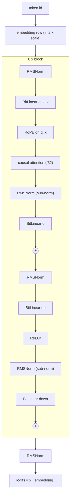

# How trit works

This is the long version of the README's overview: the network, what
"1.58-bit" means in arithmetic, how the weights are laid out in memory, and
what the kernels do with them.

- [The network](#the-network)
- [BitLinear](#bitlinear)
- [Training](#training)
- [Memory layouts](#memory-layouts)
- [Kernels](#kernels)
- [The inference engine](#the-inference-engine)
- [Testing that it all agrees](#testing-that-it-all-agrees)

## The network

A small decoder-only transformer in the Llama mould, with the changes BitNet
b1.58 makes:



| | |
|---|---|
| width | 384 |
| layers | 8 |
| heads | 6 of 64 dimensions |
| feed-forward | 1536, squared ReLU (1374 to 1536 stored per layer, see below) |
| vocabulary | 4,096 byte-level BPE tokens |
| context | 512 tokens |
| ternary weights | 14,155,776 trained, 13,851,648 stored |
| embedding | 1,572,864, tied to the output |

Every matrix inside a block is ternary. The embedding (which is also the
output layer) is not: BitNet keeps it in higher precision, and here it is
int8 with one scale per row, which costs 1.57 MB of the file.

**Sub-norms.** The two extra RMSNorms, before the attention output projection
and before the feed-forward down projection, are from BitNet b1.58 2B4T.
Each BitLinear quantizes its input to int8 per token with an absmax scale; a
norm right in front keeps that input's range steady, so one outlier does not
flatten everything else to zero.

**Squared ReLU instead of SwiGLU.** BitNet b1.58 2B4T uses ReLU², and for a
ternary model it has two practical advantages. It needs two matrices instead
of three, so for the same parameter count the hidden layer is 1.5 times wider
(1536 instead of 1024). And it makes the hidden activations sparse: on the
validation set, 90.4% of them are exactly zero after the ReLU (`trit_train.reference` reports it).

**Dead units.** 396 of the 12,288 hidden units ended training with an all-zero
row of `w_up`, so they output 0 for every token. Export drops them along
with their sub-norm weight and `w_down` column (version 2 of the
[file format](format.md#version-2)), which removes 304,128 ternary weights.
The sub-norm still divides by the trained width of 1536, and because adding
0.0 to a float sum leaves it unchanged, the engine's output is bit-identical
to the unpruned file's.

## BitLinear

A normal linear layer computes `y = W x`. BitLinear computes

```
γ   = mean(|W|)                          one scale per matrix
W_t = clamp(round(W / γ), -1, 1)         every entry -1, 0 or +1

s   = 127 / max(|x|)                     one scale per token
x_q = clamp(round(x · s), -128, 127)     8-bit integers

y   = (W_t · x_q) · γ / s
```

The product `W_t · x_q` is integer arithmetic with no multiplications at all
(each weight adds, subtracts or skips an activation), and it is *exact*, so
the only rounding in a BitLinear is in quantizing `x` and in the final
multiplication by `γ / s`.

**Training it.** `round` has zero gradient almost everywhere, so training
uses the straight-through estimator: the forward pass sees the quantized
values, the backward pass pretends quantization is the identity. In PyTorch
that is one line each:

```python
x_ste = x + (x_q / s - x).detach()
w_ste = w + (w_t * γ - w).detach()
y = F.linear(x_ste, w_ste)
```

The optimizer keeps full-precision "latent" weights and updates them as
usual; only their quantized shadow is ever used in the forward pass. Once
training ends the latent weights are thrown away and `W_t` and `γ` are all
that is exported. Nothing is approximated at export: the trained network
already ran on exactly these trits.

## Training

[`train/`](../train) is a uv project.

1. **Tokenizer** (`trit_train.tokenizer`): byte-level BPE with 4,096 tokens,
   trained with Hugging Face `tokenizers` on the first 400 MB of
   TinyStoriesV2-GPT4. The pre-tokenizer regex is
   `'(?:s|t|re|ve|m|ll|d)| ?\p{L}+| ?\p{N}| ?[^\s\p{L}\p{N}]+|\s+`: GPT-2's,
   minus the look-ahead, so that the Rust side can implement it with a short
   hand-written scanner instead of shipping a regex engine.
2. **Data** (`trit_train.data`): the whole 2.2 GB train split becomes 552M
   uint16 tokens, each story preceded by `<|endoftext|>`. Training samples
   random 512-token windows.
3. **Training** (`trit_train.train`): AdamW (β = 0.9, 0.95, weight decay 0.1),
   batch 32 x 512, 500 warm-up steps then cosine decay to 10%, bf16 autocast,
   `torch.compile`. The ternary model trains at a peak learning rate of 2e-3
   (BitNet models want higher rates than full-precision ones), the baseline at
   1e-3. Neither rate was tuned.
4. **Export** (`trit_train.export`) and **check** (`trit_train.reference`): see
   below.

## Memory layouts

The file stores five trits per byte as a plain base-3 number
([format.md](format.md)). That is the densest practical encoding, but
pulling one trit out of it takes a division, and SIMD units have no byte
division. So on load the engine repacks each matrix into a layout built for
the kernels. Both layouts store a row as a sequence of 32-byte blocks, and
in both, **byte `j` of a block holds one weight from each of several
32-column stripes**. One SIMD instruction on the 32 bytes then yields 32
weights for 32 *consecutive* columns, ready to multiply against 32
consecutive activations without any shuffling.

**I2, 2 bits per weight.** Four trits per byte, stored as `t + 1` in two bits:

```
block b covers columns 128b .. 128b + 127

byte j:   bits 7-6       bits 5-4       bits 3-2       bits 1-0
          col 96 + j     col 64 + j     col 32 + j     col j
```

Decoding stripe `k` of the block is `(bytes >> 2k) & 3`: one shift and one
AND for 32 weights.

**TQ, 1.6 bits per weight.** Five trits per byte, 160 columns per block.
The digits `d_k = t_k + 1` make the base-3 number
`v = 81 d_0 + 27 d_1 + 9 d_2 + 3 d_3 + d_4`, but the byte stores it as a
fixed-point fraction instead:

```
q = ceil(256 · v / 243)
```

`q / 256` is then (just above) `v / 243`, whose base-3 expansion is
`0.d_0 d_1 d_2 d_3 d_4`. Multiplying by 3 moves the next digit in front of
the point: `d_0 = floor(3q / 256)`, then `q ← 3q mod 256` and repeat. In
bytes, `3q mod 256` is two wrapping adds, and `floor(3q / 256)` is
`(q ≥ 86) + (q ≥ 171)`: two unsigned compares. The rounding up in `ceil`
leaves just enough headroom that all five digits come out right for every
one of the 243 values; a unit test checks each one. (llama.cpp's TQ1_0 type
uses the same trick.)

The kernels never decode to `t` itself. They decode to the digit `d = t + 1`
in {0, 1, 2}, because that is a valid *unsigned* byte, and x86's byte
multiply-accumulate instructions want one unsigned operand. The difference
is fixed once per row:

```
Σ t·x  =  Σ (d − 1)·x  =  Σ d·x  −  Σ x
```

`Σ x` is computed once per activation vector and shared by every row of every
matrix that reads it.

**Padding.** Rows are padded with zero weights to a whole number of blocks.
For this model's width of 384 that costs nothing in I2 (three blocks exactly)
but a quarter in TQ (384 columns need 2.4 blocks, so three), which is one
reason the engine uses I2 by default and the file does not use either.

## Kernels

[`crates/trit-kernels`](../crates/trit-kernels) multiplies a packed ternary
matrix by an int8 vector, with four implementations chosen at run time:

| kernel | per 32 weights | instruction doing the multiply-add |
|---|---|---|
| scalar | a loop | `i32 += d * x` |
| AVX2 | shift, AND (I2) or 2 compares, 2 subs, 2 adds (TQ) | `vpmaddubsw` (u8 x i8 → i16 pairs), `vpmaddwd` to widen |
| AVX-512 VNNI | the same on 64 bytes at a time, compares into mask registers | `vpdpbusd` (u8 x i8, four products into each i32) |
| WASM SIMD128 | shift and AND, or two `u8x16.ge` | `i16x8.extmul_low/high_i8x16`, widened once per block |

The AVX-512 kernel keeps one accumulator per stripe. `vpdpbusd` has a latency
of several cycles, and with a single accumulator every instruction waits for
the previous one; with four independent chains the I2 kernel became about
twice as fast on the 4096-wide shapes ([devlog](devlog.md#the-avx-512-kernel-was-no-faster-than-avx2)).

There is no LUT (table lookup) kernel. That approach, from T-MAC and
bitnet.cpp, pays off on CPUs without fast int8 dot products; on a CPU with
VNNI the straightforward kernel already does 64 multiply-adds per
instruction, and decoding I2 costs two cheap ops per 64 weights.

Throughput numbers are in the README and in [`bench/`](../bench).

## The inference engine

[`crates/trit-model`](../crates/trit-model) runs one token at a time:

1. Look up the token's embedding row (int8 times its row scale).
2. For each block: RMSNorm, quantize to int8 once, then the q, k and v
   GEMVs share that quantized vector. RoPE, append k and v to the cache,
   attention over the cache in f32. Sub-norm, quantize, o projection,
   residual. Norm, quantize, up projection, ReLU², sub-norm, quantize, down
   projection, residual.
3. Final norm, then the logits against the int8 embedding in f32.

The KV cache is f32 (8 layers x 512 positions x 384 x 2 = 12.6 MB at full
context, more than the weights). Generation starts every story with
`<|endoftext|>`, because that is what precedes every story in training.

Sampling is temperature and top-p with a SplitMix64 generator. Everything in
the forward pass is either exact integer work or basic IEEE float arithmetic,
which every platform computes identically, except for `exp`, `sin` and `cos`,
which come from each platform's maths library. Those few calls go through
[`math.rs`](../crates/trit-model/src/math.rs) instead (a polynomial `exp`, and
`sin`/`cos` in f64 rounded once), so a seed writes the same story in the CLI
on x86 and in the browser on WebAssembly.

## Testing that it all agrees

- **Kernels against a dense reference.** 1,500 seeded random shapes (1 to
  12 rows, 1 to 800 columns, both layouts) plus every column count around
  every block edge up to five blocks, run through every kernel the machine
  has; results must be *equal*, not close. A separate test pushes the
  16-bit intermediate sums to their limits.
- **Rust against PyTorch.** `trit_train.reference` is a float32 PyTorch
  forward pass written directly against the exported file, step for step like
  the Rust engine. It writes the logits for a fixed prompt; the Rust test
  requires every position's argmax to match and the largest difference to stay
  below 1e-5 of the logit range. It is around 5e-7.
- **Tokenizer against Hugging Face.** The same script records `tokenizers`'
  output for a set of awkward strings (contractions, digits, runs of spaces,
  accented letters, curly quotes, an emoji, CJK); the Rust tokenizer must
  produce identical ids and decode back to identical text.
- **Kernels against each other.** Because the integer GEMV is exact, every
  kernel and both layouts must give *bit-identical* logits for a sequence.
- **Browser against CLI.** The end-to-end tests replay stories recorded with
  the native CLI in Chrome and require the same text, character for character.
- **Training model against the file.** A Python test builds a small model,
  exports it, reads it back and checks the reference forward pass reproduces
  the training model's own output.
